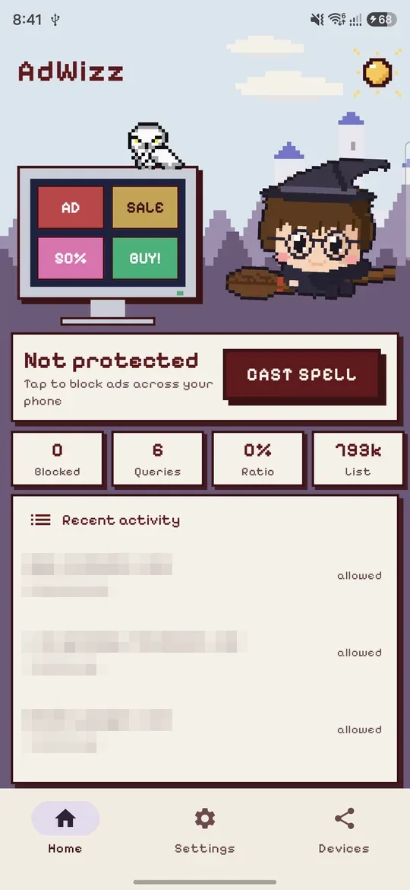
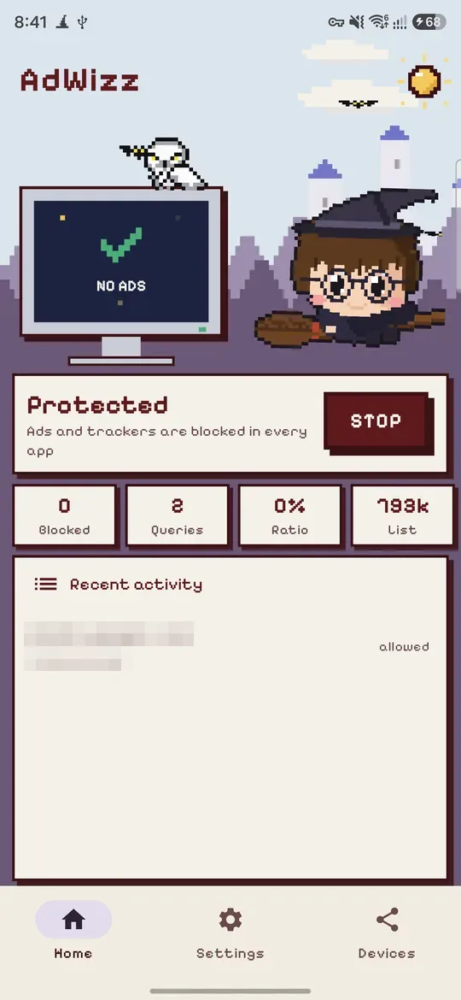
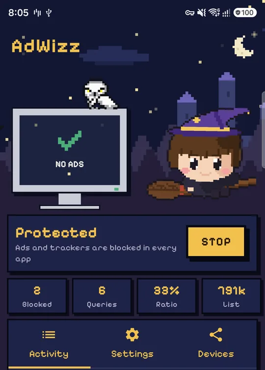
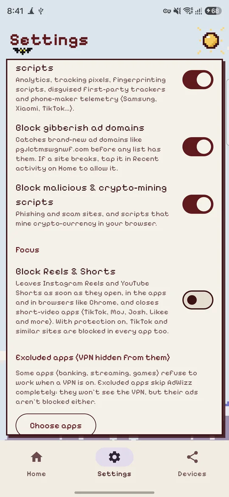
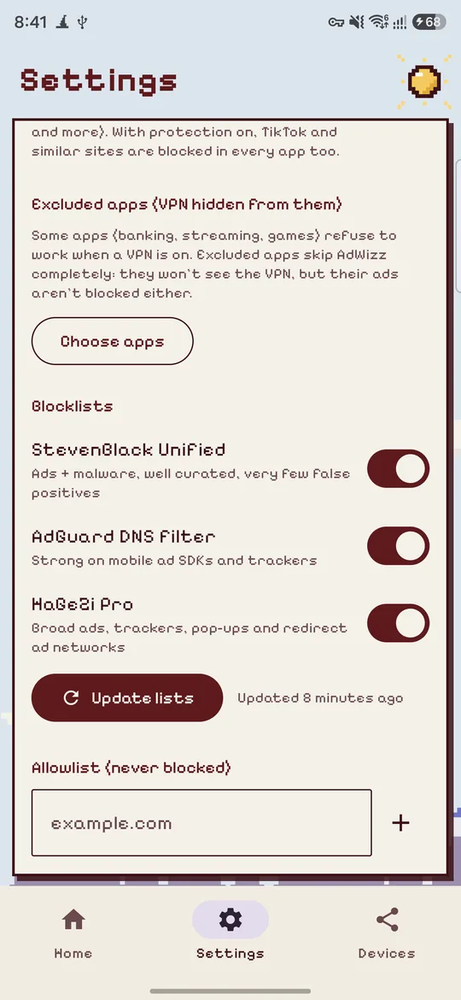
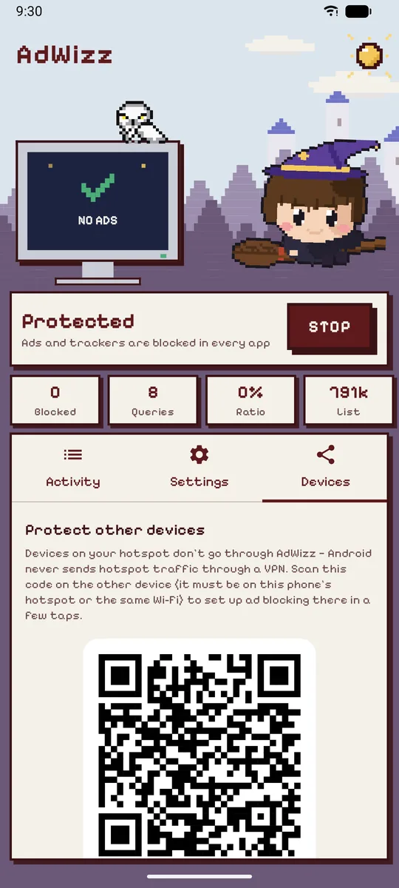

<p align="center">
  
</p>

<h1 align="center">AdWizz</h1>

<p align="center">
  <b>One spell, and the ads vanish — in every app on your Android phone.</b><br>
  No root · no account · your browsing never leaves your phone · about 2 MB
</p>

<p align="center">
  <a href="https://github.com/ChiragKushwaha/AdWizz/releases/latest/download/AdWizz.apk"><b>⬇ Download the APK</b></a> ·
  <a href="https://chiragkushwaha.github.io/AdWizz/">Website</a> ·
  <a href="https://github.com/ChiragKushwaha/AdWizz/releases">All releases</a>
</p>

<p align="center">
  
  &nbsp;
  
  &nbsp;
  
</p>
<p align="center">
  
  &nbsp;
  
  &nbsp;
  
</p>

---

## 🧙 What is this sorcery?

Ads are everywhere: in games, in news apps, in every browser tab trying to open a "you won!" pop-up.
AdWizz is a tiny wizard who lives on your phone and makes them disappear.

Tap **Cast spell**, the wizard raises his wand, and the ads on his little monitor levitate, float off
into the sky and vanish in a puff of cloud. From then on, ads in *every* app on your phone simply
never arrive. 🪄

## 📜 The spellbook (what it blocks)

| Spell | What it does |
|---|---|
| 🚫 **Ad banishing** | Banners, video ads and interstitials in every app and browser |
| 🌀 **Anti-pop-up ward** | Pop-under tabs and redirect chains never open |
| 🕵️ **Tracker blindness** | Analytics, tracking pixels, fingerprinting scripts, phone-maker telemetry |
| 🔮 **Gibberish detector** | Spots brand-new ad domains like `pgjlctmswgnwf.com` before any list knows them |
| 🎭 **Unmasking** | Catches trackers disguised as the site's own address (CNAME cloaking) |
| 🛡️ **Anti-dark-magic** | Phishing sites and crypto-mining scripts |
| 🧱 **Bypass barrier** | Apps that sneak around your DNS (hard-coded Google/Cloudflare, DNS-over-HTTPS) get caught |
| 🎬 **Scroll-stopper** | Optional: backs out of Instagram Reels and YouTube Shorts, and closes TikTok, Moj, Josh and Chingari |
| 🙈 **Invisibility cloak** | Exclude banking/streaming apps that refuse to run with a VPN |
| 📡 **Share the magic** | A QR code sets up ad blocking on iPhones, Macs and laptops on your hotspot |
| ✨ **Self-renewing** | Tells you when a new version is out and updates in one tap |

Tested against [canyoublockit.com](https://canyoublockit.com/extreme-test/): every live ad
network on its "eXtreme" test page is blocked, and no pop-under opens.

## 📲 Install

1. On your phone, open **[the latest APK](https://github.com/ChiragKushwaha/AdWizz/releases/latest/download/AdWizz.apk)**.
2. If asked, allow your browser to *install unknown apps* (one time).
3. Open AdWizz, tap **Cast spell**, accept Android's VPN prompt.
4. That's it. Updates arrive inside the app.

> **Play Protect may say it doesn't recognise the app.** That's normal for apps installed outside the
> Play Store; tap *Install anyway*. Google Play doesn't allow apps that block other apps' ads, which
> is why AdWizz lives here.

**Settings that matter:** Private DNS must be *Off* or *Automatic* (AdWizz warns you if not), and
Chrome's "Use secure DNS" shouldn't be set to a custom provider. Turn on **Always-on VPN** for
AdWizz so protection survives reboots.

## 🔍 How the magic actually works

No magic, just DNS. AdWizz runs a *local* VPN that only carries DNS look-ups, so everything else
(your browsing, video, downloads) goes straight over your normal connection at full speed.

```
 any app ──"where is ads.example.com?"──► AdWizz (on your phone)
                                              │
                        ┌──── on a blocklist? ────┐
                       yes                        no
                        │                          │
          "it doesn't exist" (0.0.0.0)     ask your DNS server (Cloudflare,
          → the ad never loads             AdGuard, …) → normal answer
```

- **Lists:** a built-in starter list (works offline) plus StevenBlack, AdGuard DNS, HaGeZi Pro,
  EasyPrivacy, phone-maker telemetry lists, Phishing Army and NoCoin — about 790,000 domains,
  refreshed every 2 days, stored in a compact table (about 25 bytes per domain) so it stays light.
- **Reels & Shorts:** these come from the same servers as the rest of Instagram and YouTube, so DNS
  can't block them. The optional *Block Reels & Shorts* switch uses an Accessibility service instead:
  it checks which screen those apps are showing and presses Back when it's a short-video player.
  That service ships as a separate 50 KB add-on, *AdWizz Reels Blocker*, which AdWizz downloads and
  installs when the switch is turned on. Play Protect blocks any downloaded app that can use
  Accessibility, so keeping it out of AdWizz lets the ad blocker itself install normally.
- **Limits:** ads served from the *same* servers as the content (YouTube, Instagram feed ads, and
  the video ads stitched into Prime Video, JioHotstar and other streams) can't be separated by DNS —
  no DNS blocker can. When an in-app banner is blocked, the app may leave an empty gap where it would
  have been: AdWizz can't change another app's layout. Devices on your hotspot don't pass through an
  Android VPN, which is what the Devices screen's QR code is for.

## 🔒 Privacy

No account, no servers of our own, and your browsing and DNS look-ups never leave your phone: the
list of what was blocked lives only in your phone's memory. AdWizz talks to the DNS server you choose,
the public blocklist mirrors, this repo's website (to check for updates), and Google Firebase for
anonymous usage statistics and crash reports (app opens, app version, device model). It never sends the sites or apps you use, and the advertising ID is turned off.
The optional Reels & Shorts blocker only looks at Instagram, YouTube and short-video apps, only
checks which screen is open (not what's on it), and keeps nothing.

---

## 🛠️ For developers

### Build

Open the folder in Android Studio and press **Run**, or:

```bash
export JAVA_HOME="/Applications/Android Studio.app/Contents/jbr/Contents/Home"
./gradlew assembleDebug         # app/build/outputs/apk/debug/app-debug.apk
./gradlew assembleRelease       # signed with your key if keystore.properties exists
```

### Test

- `./gradlew testDebugUnitTest` — 203 JVM + Robolectric tests: packet/DNS parsing (with fuzzing),
  blocklists, the update manifest, the share server, every UI screen, the theme reveal and the spell.
- `./gradlew testDebugUnitTest -Plive=true` — also checks canyoublockit.com against the live lists.
- `scripts/device-adblock-test.sh` — on a connected phone with a debug build: opens the test site in
  Chrome and checks every ad host was blocked and no pop-under opened.

### Release (GitHub Releases + in-app updates)

1. Bump `versionCode` (+1) and `versionName` in `app/build.gradle.kts`, commit.
2. `scripts/release.sh "What's new"` — tests, builds the signed APK, writes `docs/update.json`,
   tags, pushes and creates the GitHub release with `AdWizz.apk`.
3. Installed apps check `update.json` daily (also from the VPN's background job), download and verify
   the APK (SHA-256 and signing key) and notify *"AdWizz vX is ready"*. One tap installs; on Android 12+
   every update after the first installs without Android's extra confirm screen.

Needs the GitHub CLI (`brew install gh && gh auth login`) and `keystore.properties` (gitignored) for the
release key. **Back up the key and that file** — without them you can't ship updates.

Website: `docs/` on GitHub Pages. Fresh screenshots: `scripts/capture-screenshots.sh` with a phone connected.

### Code map

| Path | What lives there |
|---|---|
| `core/` | Plain Java, no Android: `IpPacket`/`IpBuilder`/`Bytes` (packets), `DnsMessage`/`DnsResponse` (DNS), `DomainSet` + `DomainHash` (compact domain table), `DomainMatcher`, `ListParser`, `GeneratedDomain` |
| `vpn/` | `AdBlockVpnService` (lifecycle), `TunnelSetup` + `ResolverLists`, `PacketPump` (read → filter → answer), `UpstreamDns`, `NetworkWatcher`, `Maintenance`, notification, Quick Settings tile |
| `data/` | `Settings`, `Sources`, `BlocklistRepository` + downloader, `VpnState`, updater (`Updater`, `UpdateNotifier`, `ApkInstaller`, …) |
| `app/…/focus/` | `FocusStateProvider`: shares the *Block Reels & Shorts* switch with the add-on (signature-only) |
| `focus/` (module) | The *AdWizz Reels Blocker* add-on: `ShortVideoBlockerService` (Accessibility service) + `FocusSwitch` (reads the switch from AdWizz). Released with `scripts/release-addon.sh` |
| `shared/focus-rules/` | `ShortVideoRules` (which screens and domains count as short video), compiled into both apps |
| `share/` | The Devices screen's local setup page: `ShareServer`, `HttpIo`, `SetupPage`, `MobileConfig`, `LanAddress` |
| `ui/` | Compose UI: `AppScreen` (bottom bar: Home / Settings / Devices), home (`WizardStage` + `Stage*`), settings sections, pixel kit, theme + radial reveal |
| `scripts/` | `make_wizard.py` (wizard art + icons), `extract_design_assets.py`, release (app + add-on), screenshots, device test |
| `docs/` | The website |

Every source file is kept under ~120 lines.

## 📄 License

[MIT](LICENSE) © 2026 Chirag Kushwaha.
Font: [Pixelify Sans](licenses/PixelifySans-OFL.txt) (SIL Open Font License). Blocklists belong to
their authors (StevenBlack, AdGuard, HaGeZi, EasyPrivacy/firebog, Frogeye, Phishing Army, NoCoin).
