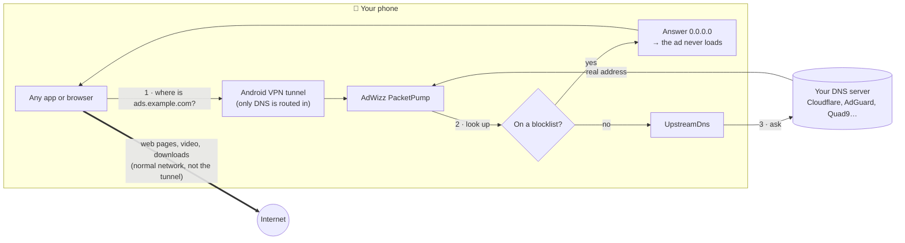
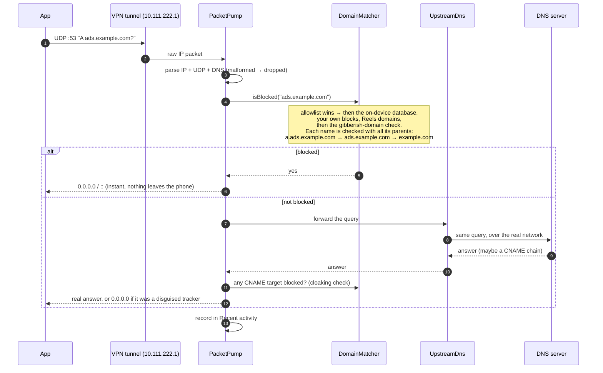
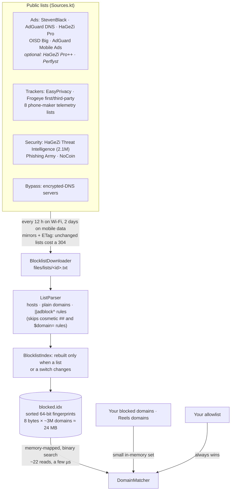
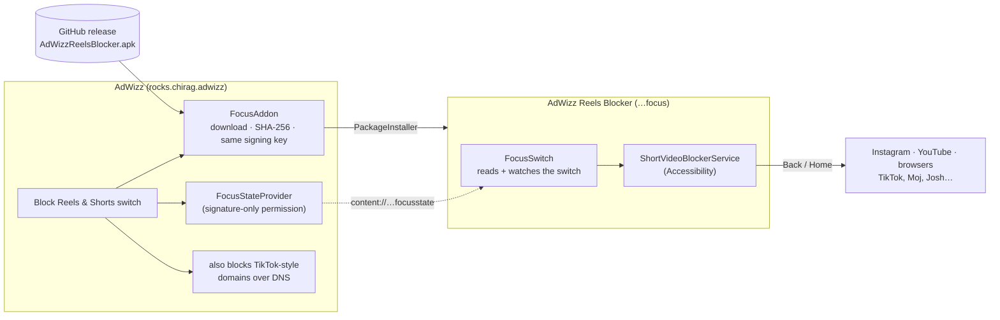
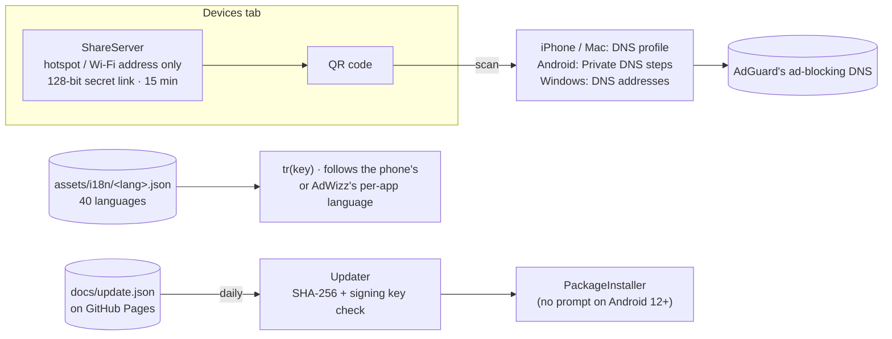
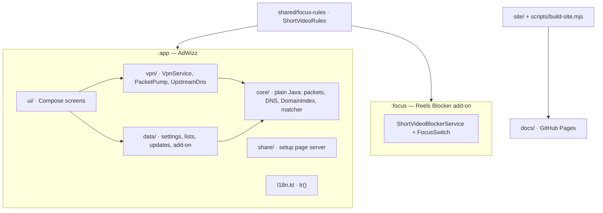

<p align="center">
  
</p>

<h1 align="center">AdWizz</h1>

<p align="center">
  <b>One spell, and the ads vanish — in every app on your Android phone.</b><br>
  No root · no account · your browsing never leaves your phone · about 2 MB · 40 languages
</p>

<p align="center">
  <a href="https://github.com/ChiragKushwaha/AdWizz/releases/latest/download/AdWizz.apk"><b>⬇ Download the APK</b></a> ·
  <a href="https://chiragkushwaha.github.io/AdWizz/">Website</a> ·
  <a href="https://github.com/ChiragKushwaha/AdWizz/releases">All releases</a>
</p>

<p align="center">
  
  &nbsp;
  
  &nbsp;
  
</p>
<p align="center">
  
  &nbsp;
  
  &nbsp;
  
</p>

---

## 🧙 What is this sorcery?

Ads are everywhere: in games, in news apps, in every browser tab trying to open a "you won!" pop-up.
AdWizz is a tiny wizard who lives on your phone and makes them disappear.

Tap **Cast spell**, the wizard raises his wand, and the ads on his little monitor levitate, float off
into the sky and vanish in a puff of cloud. From then on, ads in *every* app on your phone simply
never arrive. 🪄

## 📜 The spellbook (what it blocks)

| Spell | What it does |
|---|---|
| 🚫 **Ad banishing** | Banners, video ads and interstitials in every app and browser |
| 🌀 **Anti-pop-up ward** | Pop-under tabs and redirect chains never open |
| 🕵️ **Tracker blindness** | Analytics, tracking pixels, fingerprinting, tracking-link redirects, phone-maker telemetry |
| 🔮 **Gibberish detector** | Spots brand-new ad domains like `pgjlctmswgnwf.com` before any list knows them |
| 🎭 **Unmasking** | Catches trackers disguised as the site's own address (CNAME cloaking) |
| 🛡️ **Anti-dark-magic** | 2 million+ phishing, scam and malware domains, and crypto-mining scripts |
| 🧱 **Bypass barrier** | Apps that sneak around your DNS (hard-coded Google/Cloudflare, DNS-over-HTTPS) get caught |
| 🎬 **Scroll-stopper** | Optional add-on: backs out of Instagram Reels and YouTube Shorts, closes TikTok, Moj, Josh and Chingari |
| 🙈 **Invisibility cloak** | Exclude banking/streaming apps that refuse to run with a VPN |
| 📡 **Share the magic** | A QR code sets up ad blocking on iPhones, Macs and laptops on your hotspot or Wi-Fi |
| 🌍 **Polyglot** | The app and the website speak 40 languages and follow your phone's language |
| ✨ **Self-renewing** | Lists refresh every 12 hours; new versions update in one tap |

Tested against [canyoublockit.com](https://canyoublockit.com/extreme-test/): every live ad
network on its "eXtreme" test page is blocked, and no pop-under opens.

## 📲 Install

1. On your phone, open **[the latest APK](https://github.com/ChiragKushwaha/AdWizz/releases/latest/download/AdWizz.apk)**.
2. If asked, allow your browser to *install unknown apps* (one time).
3. Open AdWizz, tap **Cast spell**, accept Android's VPN prompt.
4. That's it. Updates arrive inside the app.

> **Play Protect may say it doesn't recognise the app.** That's normal for apps installed outside the
> Play Store; tap *Install anyway*. Google Play doesn't allow apps that block other apps' ads, which
> is why AdWizz lives here. **"App not installed"?** An older copy signed with a different key (e.g. a
> test build) is on the phone: uninstall it once, then install again.

**Settings that matter:** Private DNS must be *Off* or *Automatic* (AdWizz warns you if not), and
Chrome's "Use secure DNS" shouldn't be set to a custom provider. Turn on **Always-on VPN** for
AdWizz so protection survives reboots.

## 🔍 How the magic actually works

No magic, just DNS. Before an app can load an ad it has to look up the ad server's address
(`ads.example.com` → `203.0.113.7`). AdWizz answers those look-ups on the phone: ad, tracker and scam
names get "nothing here" (`0.0.0.0`), so the ad never loads; everything else gets the real answer.
Only DNS goes through AdWizz, so browsing, video and downloads run over your normal connection at
full speed.



### What happens to one DNS look-up



### The techniques

| Technique | How | Where |
|---|---|---|
| **DNS sinkhole** | Blocked names get `0.0.0.0` / `::` instantly | `PacketPump`, `DnsMessage` |
| **Parent matching** | `x.y.ads.com` is blocked if `ads.com` is listed, without allocating substrings | `DomainMatcher` |
| **CNAME uncloaking** | After the real answer arrives, every CNAME target is checked too | `PacketPump`, `DnsResponse` |
| **Gibberish detection** | A site name of 11+ letters and no vowels (`pgjlctmswgnwf.com`) is an ad domain. Checked against the top 100k sites | `GeneratedDomain` |
| **DNS-bypass blocking** | Well-known public resolvers (8.8.8.8, 1.1.1.1…) are routed into the tunnel too: DNS to them is filtered, DoH/DoT is refused so apps fall back to plain DNS. DoH hostnames are on a blocklist, and Firefox's DoH canary gets NXDOMAIN | `TunnelSetup`, `ResolverLists`, `PacketPump` |
| **Private DNS warning** | If Android's Private DNS skips the VPN, Home shows a warning | `HomeStatus` |
| **Short-video blocker** | An Accessibility service backs out of Reels / Shorts screens (add-on app) | `focus/` module |

### Blocklists → on-device database



The database is a file, not the app's heap: Android pages in only what look-ups touch and drops it
under memory pressure. On a Galaxy S24 Ultra, AdWizz's Java heap went from ~50 MB (old in-memory
table, 860k domains) to ~16 MB with 3M domains. A fingerprint collision would need two names to share
64 bits: with 3M entries, about 1 false match in 6 trillion look-ups. A live test checks that the
default lists never block hosts popular apps need (YouTube's video servers, Instagram, WhatsApp, UPI
apps…).

### Reels & Shorts add-on

Reels and Shorts come from the same servers as the rest of Instagram and YouTube, so DNS can't block
them. An Accessibility service can: it sees which screen those apps show and presses Back on a
short-video player. Play Protect hard-blocks any *downloaded* app that can use Accessibility, so that
service lives in a separate 22 KB app, **AdWizz Reels Blocker**, and AdWizz itself installs normally.



After install, AdWizz walks the user through Android 13+'s "Restricted setting" with three
illustrated steps (drawn in Compose, no images).

### Other devices, updates and languages



- **Devices:** Android never routes hotspot traffic through a VPN, so other devices get AdGuard's
  public ad-blocking DNS instead, set up from a QR code. On Android 17 this needs the *Nearby
  devices* permission. The Apple profile is system-scoped so macOS 26.1+ accepts it.
- **Languages:** translations are compressed assets rather than Android string resources (those are
  stored uncompressed), so 40 languages cost ~200 KB instead of ~800 KB. Right-to-left languages
  (Arabic, Urdu, Persian, Hebrew) flip the layout automatically.
- **Limits:** ads served from the *same* servers as the content (YouTube, Instagram feed ads, and
  the video ads stitched into Prime Video, JioHotstar and other streams) can't be separated by DNS —
  no DNS blocker can. When an in-app banner is blocked, the app may leave an empty gap where it would
  have been: AdWizz can't change another app's layout.

## 🔒 Privacy

No account, no servers of our own, and your browsing and DNS look-ups never leave your phone: the
blocklists and your Recent activity live only on your phone. AdWizz talks to the DNS server you choose,
the public blocklist mirrors, this repo's website (to check for updates), and Google Firebase for
anonymous usage statistics and crash reports (app opens, app version, device model). It never sends
the sites or apps you use, and the advertising ID is turned off. The optional Reels & Shorts add-on
only looks at Instagram, YouTube, short-video apps and browsers' address bars, and keeps nothing.

---

## 🛠️ For developers

### Build

Open the folder in Android Studio and press **Run**, or:

```bash
export JAVA_HOME="/Applications/Android Studio.app/Contents/jbr/Contents/Home"
./gradlew assembleDebug         # app/build/outputs/apk/debug/app-debug.apk (+ the add-on)
./gradlew assembleRelease       # signed with your key if keystore.properties exists
```

Debug builds install as `rocks.chirag.adwizz.debug` ("AdWizz Debug"), next to the real app.

### Test

- `./gradlew testDebugUnitTest` — 300+ JVM + Robolectric tests: packet/DNS parsing (with fuzzing),
  list parsing, the on-device database, downloads, the update manifest, the share server, the add-on,
  every screen (including rotation and leaks), translations, the theme reveal and the spell.
- `./gradlew testDebugUnitTest -Plive=true` — also downloads today's real lists: canyoublockit.com
  is blocked and popular apps keep working.
- `scripts/device-adblock-test.sh` — on a connected phone with a debug build: opens the test site in
  Chrome and checks every ad host was blocked and no pop-under opened. LeakCanary runs in debug builds.

### Translations and website

```bash
node scripts/translate.mjs        # fills in every language (app + website), only what's missing
node scripts/build-site.mjs       # docs/index.html + docs/<lang>/index.html + sitemap.xml
```

English lives in `app/src/main/assets/i18n/en.json` (app) and `site/i18n/en.json` (website); the
language list in `i18n/languages.json`. Each website page has its own canonical URL, `hreflang`
links to every language, `og:locale` and translated structured data (app + FAQ).

### Release (GitHub Releases + in-app updates)

1. Bump `versionCode` (+1) and `versionName` in `app/build.gradle.kts`, commit.
2. `scripts/release.sh "What's new"` — tests, builds the signed APK, writes `docs/update.json`,
   rebuilds the website, tags, pushes and creates the GitHub release with `AdWizz.apk`.
3. Add-on changed? Bump it in `focus/build.gradle.kts` and run `scripts/release-addon.sh`.

Installed apps check `update.json` daily, download and verify the APK (SHA-256 and signing key) and
notify *"AdWizz vX is ready"*. Needs the GitHub CLI and `keystore.properties` (gitignored) for the
release key. **Back up the key and that file** — without them you can't ship updates.

Fresh screenshots: `scripts/capture-screenshots.sh` with a phone connected. Wizard art, icons and the
website's images: `python3 scripts/make_wizard.py`.

### Code map



| Path | What lives there |
|---|---|
| `core/` | Plain Java, no Android: `IpPacket`/`IpBuilder`/`Bytes` (packets), `DnsMessage`/`DnsResponse` (DNS), `DomainIndex` (on-device blocklist database), `DomainSet` + `DomainHash` (small in-memory sets), `DomainMatcher`, `ListParser`, `GeneratedDomain` |
| `vpn/` | `AdBlockVpnService` (lifecycle), `TunnelSetup` + `ResolverLists`, `PacketPump` (read → filter → answer), `UpstreamDns`, `NetworkWatcher`, `Maintenance`, notification, Quick Settings tile |
| `data/` | `Settings`, `Sources`, `BlocklistRepository` + `BlocklistDownloader` + `BlocklistIndex`, `VpnState`, updater (`Updater`, `UpdateNotifier`, `ApkInstaller`), `FocusAddon` |
| `app/…/focus/` | `FocusStateProvider`: shares the *Block Reels & Shorts* switch with the add-on (signature-only) |
| `focus/` (module) | The *AdWizz Reels Blocker* add-on: `ShortVideoBlockerService` (Accessibility service) + `FocusSwitch` (reads the switch from AdWizz) |
| `shared/focus-rules/` | `ShortVideoRules` (which screens and domains count as short video), compiled into both apps |
| `share/` | The Devices screen's local setup page: `ShareServer`, `HttpIo`, `SetupPage`, `MobileConfig`, `LanAddress` |
| `ui/` | Compose UI: `AppScreen` (bottom bar: Home / Settings / Devices), home (`WizardStage` + `Stage*`), settings sections, Reels setup guide, pixel kit, theme + radial reveal |
| `I18n.kt` | `tr()` and the language list; texts in `assets/i18n/` |
| `site/`, `i18n/` | Website template + texts, shared language list |
| `scripts/` | `make_wizard.py` (art + icons), `translate.mjs`, `build-site.mjs`, release (app + add-on), screenshots, device test |
| `docs/` | The website (generated pages, sitemap, update.json) |

Source files are kept short (about 120 lines).

## 📄 License

[MIT](LICENSE) © 2026 Chirag Kushwaha.
Font: [Pixelify Sans](licenses/PixelifySans-OFL.txt) (SIL Open Font License). Blocklists belong to
their authors (StevenBlack, AdGuard, HaGeZi, OISD, EasyPrivacy/firebog, Frogeye, Perflyst, Phishing Army, NoCoin).
